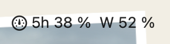
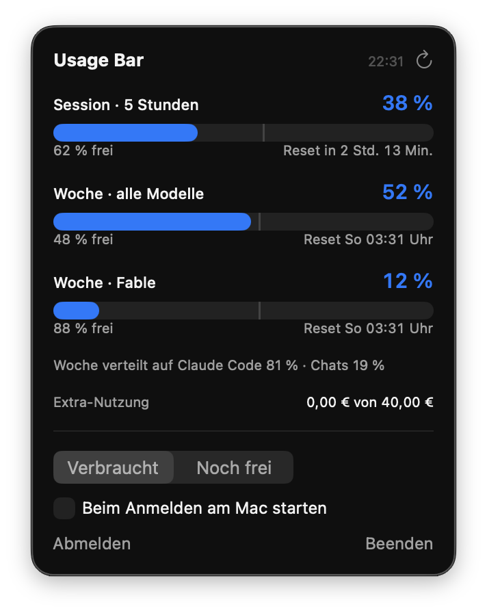

# Usage Bar

Usage Bar zeigt dir oben in der Mac-Menüleiste, wie viel von deinem Claude-Limit schon weg ist. Einmal für die aktuelle 5-Stunden-Session und einmal für die Woche. Du musst also nicht mehr ständig in die Einstellungen schauen, um zu wissen, ob du noch Luft hast.



Klickst du drauf, siehst du alle Details:



## Installieren

Du musst nichts selbst einrichten. Öffne Claude Code (in der Claude-Desktop-App der Tab „Code“ oder im Terminal), kopier diesen Prompt rein und schick ihn ab:

```
Installiere mir die Mac-App „Usage Bar“. Hol dir mit curl die Anleitung von https://raw.githubusercontent.com/heyfreiheit/usage-bar/main/INSTALL.md und arbeite sie komplett ab. Mach alles selbst und sag mir nur Bescheid, wenn ich etwas bestätigen oder mich einloggen muss.
```

Claude prüft deinen Mac, baut die App und startet sie. Fehlen die Entwicklerwerkzeuge von Apple, installiert Claude die gleich mit, du klickst dann nur einmal auf „Installieren“. Am Ende geht ein Fenster auf, in dem du dich ganz normal bei claude.ai anmeldest. Danach stehen deine Limits oben in der Menüleiste.

Für ein Update schickst du einfach denselben Prompt nochmal. Dein Login bleibt erhalten.

Du brauchst einen Mac mit macOS 15 (Sequoia) oder neuer und einen Claude-Plan mit Limits, also Pro oder Max.

Warum baut Claude die App, statt dass du sie runterlädst? Apple blockt Apps aus dem Internet, die nicht über Apple notarisiert sind, mit einer ziemlich abschreckenden Warnung. Wird die App direkt auf deinem Mac gebaut, gibt es diese Warnung nicht. Und du kannst jederzeit in den Code schauen, was sie macht.

## Was du siehst

„5h 38 %“ heißt: Von deinem 5-Stunden-Limit sind 38 % verbraucht. „W 52 %“ ist das Wochenlimit. Im Menü kannst du umstellen, ob oben verbraucht oder noch frei steht.

Im Menü bekommst du für jedes Limit einen Balken und siehst, wann es zurückgesetzt wird. Hast du ein eigenes Wochenlimit für ein bestimmtes Modell, taucht das auch auf. Der feine graue Strich im Balken zeigt, wie viel vom Zeitfenster schon vorbei ist. Liegt dein Balken deutlich rechts davon, verbrauchst du gerade schneller, als die Zeit vergeht. Ab 70 % wird die Anzeige orange, ab 90 % rot.

Darunter steht, wofür dein Wochenverbrauch draufging (Claude Code, Chats, Cowork), und falls du Extra-Nutzung aktiviert hast, wie viel davon schon verbraucht ist.

Die App aktualisiert sich alle 2 Minuten, beim Öffnen des Menüs und wenn dein Mac aufwacht. Sie startet automatisch mit dem Mac, das kannst du im Menü abschalten.

## So funktioniert das

Usage Bar liest dieselbe Nutzungsanzeige, die du auf claude.ai unter Einstellungen > Nutzung siehst. Dafür meldest du dich einmal im Fenster der App bei claude.ai an. Der Login bleibt im Speicher der App auf deinem Mac. Die App braucht keinen API-Key, fasst keine Passwörter an und schickt nichts irgendwohin außer an claude.ai. Es gibt kein Tracking und keinen Server von uns dazwischen.

Läuft dein claude.ai-Login nach ein paar Wochen ab, steht oben wieder „Login“. Einmal klicken, neu anmelden, weiter geht's.

## Gut zu wissen

Usage Bar ist kein offizielles Produkt von Anthropic. Die App nutzt eine Schnittstelle von claude.ai, die Anthropic nicht öffentlich dokumentiert. Ändert Anthropic daran etwas, kann die Anzeige ausfallen, bis die App angepasst ist. Falsche Zahlen zeigt sie dann nicht an, sondern eine Fehlermeldung im Menü. Die Nutzungsbedingungen von Anthropic regeln, wie claude.ai automatisiert abgefragt werden darf. Usage Bar ruft nur deine eigene Nutzungsanzeige ab, alle 2 Minuten. Ob das für dich passt, entscheidest du selbst. Nutzung auf eigenes Risiko.

## Selbst bauen

Mit installierten Xcode Command Line Tools:

```bash
git clone https://github.com/heyfreiheit/usage-bar.git
cd usage-bar
zsh scripts/install.sh
```

Das Skript legt die App nach `~/Applications/Usage Bar.app`. Den Code findest du in `Sources/UsageBar`: `UsageStore.swift` holt und liest die Daten, `Views.swift` ist alles, was du siehst. Mit `USAGE_BAR_DEMO=1` startet die App mit Beispielwerten und ohne Login, praktisch für Screenshots.

Deinstallieren steht am Ende von [INSTALL.md](INSTALL.md). Oder du sagst Claude einfach, es soll Usage Bar wieder entfernen.

## Von wem

Gebaut von Tim Hildesheim von heyfreiheit, komplett mit Claude Code. Wenn du lernen willst, wie du dir solche Tools selbst baust, komm in unsere kostenlose [Skool-Community](https://www.skool.com/heyfreiheit/about).

Lizenz: MIT, mach damit, was du willst.
